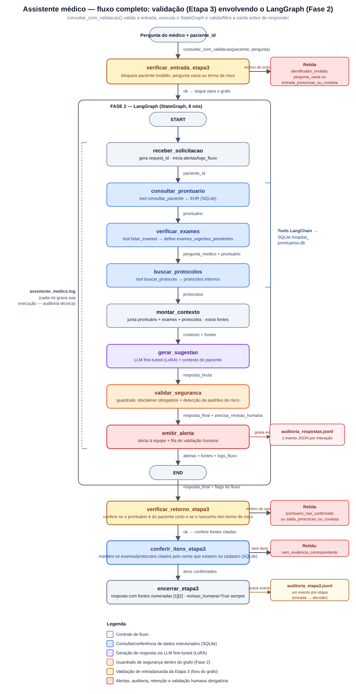

# Tech Challenge – Fase 3: Assistente Médico Virtual com Fine-Tuning, LangChain e LangGraph

Projeto da Fase 3 da pós-graduação em Inteligência Artificial para Devs (FIAP — turma 10IADT).

**Integrantes:** Alex Nascimento Gonçalves, Camila Utz, Eric Kurachi, Lucas Henrique Barbosa Silva,
Raphael Gomes.

O desafio simula um hospital que quer avançar na automação de condutas clínicas: criar um
**assistente virtual médico** treinado com dados próprios do hospital, capaz de responder dúvidas
de médicos e sugerir procedimentos com base em protocolos internos — sempre com **segurança,
auditoria e validação humana obrigatória**.

O pipeline (fine-tuning + assistente) está disponível em duas formas equivalentes:

- **Notebook** [`tech_challenge_fase3_com_fase2.ipynb`](tech_challenge_fase3_com_fase2.ipynb) — versão
  exploratória já executada (com outputs), pensada para rodar no Google Colab e aproveitar GPU
  gratuita. Organizada em duas partes:
  - **Fase 1 — Fine-tuning da LLM** (seções 1 a 14 do notebook)
  - **Fase 2 — Assistente médico com LangChain + LangGraph** (seções 15 a 23 do notebook)
- **Pacote Python** [`assistente_medico/`](assistente_medico/) — a mesma lógica modularizada em
  módulos reutilizáveis, com scripts de linha de comando em [`scripts/`](scripts/). Veja a seção
  [Estrutura do repositório](#estrutura-do-repositório) e [Como executar](#como-executar).

## Visão geral da solução

```
Dataset médico (MedQuAD)
   → limpeza / anonimização / curadoria
   → fine-tuning LoRA (Qwen2.5-0.5B-Instruct)
   → avaliação (perplexidade + qualitativa)
        │
        ▼
Adapter LoRA fine-tuned ("modelo_medquad_lora_final")
        │
        ▼
Bridge Hugging Face → LangChain (RunnableLambda)
        │
        ▼
Tools LangChain  ──►  Base SQLite sintética do hospital
 (prontuário, exames,     (pacientes, prontuários, exames, protocolos)
  protocolos)
        │
        ▼
Fluxo LangGraph (StateGraph):

  START
    → receber_solicitacao
    → consultar_prontuario
    → verificar_exames
    → buscar_protocolos
    → montar_contexto
    → gerar_sugestao            (LLM fine-tuned + contexto do paciente)
    → validar_seguranca         (guardrails + disclaimer obrigatório)
    → emitir_alerta             (exames urgentes / fila de validação humana)
  END
        │
        ▼
Resposta final + fontes (explainability) + log de auditoria
```

Versão ilustrada (com cores por categoria, dados trocados entre nós e os pontos de logging/auditoria):



## Requisitos atendidos

| Requisito do desafio | Onde está implementado |
|---|---|
| Fine-tuning de LLM com dados médicos | Seções 8–12 do notebook — LoRA sobre `Qwen/Qwen2.5-0.5B-Instruct` |
| Preprocessing, anonimização e curadoria | Seções 3–5 (`clean_text`, `PII_PATTERNS`/`anonymize`, filtro por tamanho) |
| Pipeline LangChain com a LLM customizada | Seção 17 (`RunnableLambda` + `gerar_resposta_llm`) |
| Consultas em base de dados estruturada | Seções 18–19 (SQLite: `pacientes`, `prontuarios`, `exames`, `protocolos`) |
| Contextualização com dados do paciente | `no_montar_contexto` / `no_gerar_sugestao` (seção 21) |
| Limites de atuação (sem prescrição automática) | `aplicar_guardrails` (seção 20) |
| Logging detalhado e auditoria | `assistente_medico.log` + `auditoria_respostas.jsonl` (seções 16, 20, 21) |
| Explainability (fonte da informação) | `extrair_fontes` + bloco "Fontes utilizadas" em toda resposta |
| Fluxos automatizados com LangGraph | `StateGraph` com 8 nós (seção 21) |
| Projeto modularizado em Python | pacote [`assistente_medico/`](assistente_medico/) + scripts em [`scripts/`](scripts/) |
| Diagrama do fluxo LangChain/LangGraph | [`diagrama_fluxo_langgraph.svg`](diagrama_fluxo_langgraph.svg) |
| Relatório técnico | [`RelatorioTecnico_TechChallenge_Fase3.docx.pdf`](RelatorioTecnico_TechChallenge_Fase3.docx.pdf) |
| Dataset (MedQuAD) | [`medquad.csv`](medquad.csv) — já incluído no repositório |

## Estrutura do repositório

```
.
├── tech_challenge_fase3_com_fase2.ipynb               # notebook completo (Fase 1 + Fase 2)
├── diagrama_fluxo_langgraph.svg                        # diagrama do fluxo LangChain/LangGraph
├── RelatorioTecnico_TechChallenge_Fase3.docx.pdf       # relatório técnico da entrega
├── medquad.csv                                          # dataset público MedQuAD usado no fine-tuning
├── requirements.txt                                    # dependências do projeto modularizado
├── pyproject.toml                                       # empacotamento do pacote assistente_medico
├── assistente_medico/                                   # projeto Python modularizado
│   ├── config.py                                        # constantes (modelo base, paths, seed, prompt)
│   ├── logging_utils.py                                 # configuração de logging/auditoria
│   ├── data/
│   │   ├── preprocessing.py                             # clean_text, PII_PATTERNS, anonymize
│   │   └── curation.py                                  # curadoria, split treino/val/teste, dataset
│   ├── finetuning/
│   │   ├── model.py                                     # carrega base model + aplica LoRA
│   │   ├── dataset.py                                   # tokenização
│   │   ├── train.py                                     # loop de treinamento + salvar adapter
│   │   └── evaluate.py                                  # perplexidade + avaliação qualitativa
│   └── assistant/
│       ├── llm_bridge.py                                # bridge Hugging Face → LangChain
│       ├── database.py                                  # banco SQLite sintético do hospital
│       ├── tools.py                                     # tools LangChain (prontuário/exames/protocolos)
│       ├── guardrails.py                                # guardrails, explainability, auditoria
│       ├── graph.py                                     # estado + nós + StateGraph (LangGraph)
│       └── pipeline.py                                  # perguntar_assistente, pipeline_consulta_geral
├── scripts/
│   ├── run_finetuning.py                                # CLI: executa a Fase 1 ponta a ponta
│   └── run_assistant_demo.py                            # CLI: executa a Fase 2 (3 cenários de demo)
└── README.md
```

> Observação: o projeto foi desenvolvido e executado em notebook (Google Colab) para aproveitar GPU
> gratuita. Os demais artefatos gerados durante a execução (modelo treinado, banco SQLite, splits
> curados e logs) **não são versionados no Git** — veja abaixo como gerá-los localmente.

## Como executar

### 1. Pré-requisitos

- Python 3.10+
- Recomendado: GPU com suporte a CUDA (o notebook usa quantização 4-bit via `bitsandbytes`). Sem
  GPU, o notebook também roda em CPU com `torch_dtype=float32`, apenas mais lento.
- Conta Google (para `gdown`, caso rode fora do Colab) ou acesso direto ao arquivo `medquad.csv`.

### 2. Ambiente

```bash
python -m venv .venv
source .venv/bin/activate        # Windows: .venv\Scripts\activate
pip install jupyter
```

As demais dependências são instaladas pelas próprias células do notebook (`%%capture` + `pip
install`), em dois blocos:

**Fase 1 (fine-tuning):**
```bash
pip install -q -U "transformers>=4.44" "datasets>=2.20" "peft>=0.12" "accelerate>=0.33" \
                   "bitsandbytes>=0.43" "trl>=0.9" "evaluate" "sentencepiece"
```

**Fase 2 (LangChain / LangGraph):**
```bash
pip install -q -U "langchain>=0.3" "langchain-core>=0.3" "langchain-community>=0.3" \
                   "langgraph>=0.2" "langchain-huggingface>=0.1" "sqlalchemy>=2.0"
```

### 3. Dataset

O dataset público **MedQuAD** (perguntas e respostas médicas) já está incluído no repositório como
[`medquad.csv`](medquad.csv) — não é necessário baixar nada para rodar o pipeline de fine-tuning.

Alternativamente, caso queira obter o arquivo a partir da fonte original, ele pode ser baixado via
`gdown`:

```bash
gdown --id "11bG57YsDHlf6S2m1-CuJxuL8wi-4UYmJ"
```

ou diretamente do repositório original ([abachaa/MedQuAD](https://github.com/abachaa/MedQuAD)).

### 4. Rodar o notebook

```bash
jupyter notebook tech_challenge_fase3_com_fase2.ipynb
```

Execute as células em ordem, de cima para baixo:

1. **Seções 1–14 (Fase 1 – fine-tuning):** carregam e limpam o dataset, anonimizam PII, curam os
   exemplos, fazem o split treino/validação/teste, configuram o LoRA e treinam o adapter. Ao final,
   o adapter fine-tuned é salvo em `modelo_medquad_lora_final/`.
2. **Seções 15–23 (Fase 2 – assistente):** reaproveitam o adapter salvo (ou caem de volta para o
   modelo base, caso o notebook seja executado isoladamente), criam o banco `hospital_prontuarios.db`
   com dados sintéticos, registram as tools do LangChain, montam o `StateGraph` do LangGraph e
   executam três cenários clínicos de demonstração.

### 5. Artefatos gerados durante a execução

| Artefato | Descrição |
|---|---|
| `modelo_medquad_lora_final/` | Adapter LoRA fine-tuned + tokenizer |
| `data_curada/medquad_{train,validation,test}.jsonl` | Splits do dataset curado e anonimizado |
| `hospital_prontuarios.db` | Banco SQLite sintético (pacientes, prontuários, exames, protocolos) |
| `pipeline_finetuning.log` | Log da Fase 1 (fine-tuning) |
| `assistente_medico.log` | Log detalhado de auditoria da Fase 2 (consultas, decisões do grafo, guardrails) |
| `auditoria_respostas.jsonl` | Trilha de auditoria estruturada de cada interação do assistente |

### 6. Usando o assistente programaticamente (notebook)

Depois de rodar o notebook até o fim da seção 22, a função de alto nível fica disponível:

```python
resultado = perguntar_assistente(
    "PAC-001",
    "Paciente com HAS e queixa de visão turva. Quais próximos passos segundo "
    "nossos protocolos, considerando exames pendentes?",
)

print(resultado["resposta_final"])      # resposta com disclaimer + fontes
print(resultado["alertas"])             # alertas (exames urgentes, revisão humana)
print(resultado["fontes"])              # fontes citadas (explainability)
print(resultado["precisa_revisao_humana"])  # sempre True — política institucional
```

Para uma consulta pontual sem `paciente_id` (sem passar pelo grafo completo), use o pipeline LCEL
curto da seção 23:

```python
print(pipeline_consulta_geral(
    "Quais são os sintomas clássicos de glaucoma?",
    termo_protocolo="glaucoma",
))
```

### 7. Rodando como projeto Python modularizado

Alternativa ao notebook: a mesma lógica organizada em módulos (`assistente_medico/`) e dois scripts
de linha de comando (`scripts/`).

```bash
pip install -r requirements.txt
pip install -e .          # torna o pacote assistente_medico importável

# Fase 1 — fine-tuning (gera modelo_medquad_lora_final/, data_curada/ e pipeline_finetuning.log)
python scripts/run_finetuning.py --csv medquad.csv --max-steps 10

# Fase 2 — assistente (cria hospital_prontuarios.db e executa 3 cenários de demonstração)
python scripts/run_assistant_demo.py
```

Também é possível usar os módulos diretamente em código Python:

```python
from assistente_medico.assistant.database import criar_banco_hospital
from assistente_medico.assistant.graph import build_graph
from assistente_medico.assistant.llm_bridge import LLMBridge
from assistente_medico.assistant.pipeline import perguntar_assistente

criar_banco_hospital()
llm_bridge = LLMBridge()
assistente_app = build_graph(llm_bridge)

resultado = perguntar_assistente(
    assistente_app, llm_bridge, "PAC-001",
    "Paciente com HAS e queixa de visão turva. Quais próximos passos segundo "
    "nossos protocolos, considerando exames pendentes?",
)
```

## Segurança e validação

- O assistente **nunca** fecha conduta ou prescreve medicação de forma definitiva: toda resposta
  recebe um disclaimer obrigatório e é marcada com `precisa_revisao_humana=True`.
- Respostas com linguagem de prescrição direta (`PADROES_RISCO`) disparam um aviso de bloqueio
  parcial e ficam sinalizadas para revisão humana.
- Todas as consultas às tools, decisões do grafo e interações com a LLM são registradas em
  `assistente_medico.log` (auditoria técnica) e em `auditoria_respostas.jsonl` (auditoria de
  negócio, uma linha JSON por interação).
- Cada resposta final lista explicitamente as fontes utilizadas (prontuário, exames e protocolos
  internos), atendendo ao requisito de explainability.

## Dados e privacidade

- O dataset de treinamento (MedQuAD) é público e não contém dados de pacientes reais.
- Qualquer padrão que se pareça com PII (e-mail, telefone, CPF, datas) é mascarado na etapa de
  anonimização antes da curadoria.
- A base de prontuários usada pelo assistente (`hospital_prontuarios.db`) é **100% sintética**,
  gerada por código no próprio notebook — nenhum dado real de paciente é utilizado.

## Resultados (resumo do relatório técnico)

- Dataset curado: 5.995 exemplos a partir de 16.412 registros brutos do MedQuAD (4.796 treino /
  599 validação / 600 teste).
- Fine-tuning experimental (LoRA, 10 passos): perda de treino 2,7466, perda de validação 2,7036,
  perplexidade de teste 15,17.
- Consulte o [relatório técnico completo](RelatorioTecnico_TechChallenge_Fase3.docx.pdf) para a
  análise detalhada de resultados e limitações.

## Limitações conhecidas

- O modelo base (`Qwen/Qwen2.5-0.5B-Instruct`) é pequeno, escolhido para viabilizar o fine-tuning em
  GPU gratuita (Colab); em produção, um modelo maior tende a gerar respostas mais robustas.
- O treinamento de demonstração usa `max_steps=10` por padrão, suficiente para validar o pipeline
  ponta a ponta — para um fine-tuning completo, ajuste `num_train_epochs`/`max_steps` em
  `TrainingArguments`.
- A busca de protocolos (`buscar_protocolo`) usa correspondência por palavra-chave (`LIKE`), não
  busca semântica.
- O mascaramento de PII é feito por expressões regulares e não garante anonimização completa; um
  teste registrado no relatório também identificou um caso em que a detecção textual de sugestão de
  prescrição não capturou o padrão de risco (o aviso de revisão humana, porém, continuou sendo
  exibido).
- Resultados e exemplos ainda não foram validados clinicamente por especialistas — o protótipo é
  experimental e não deve orientar condutas reais.
